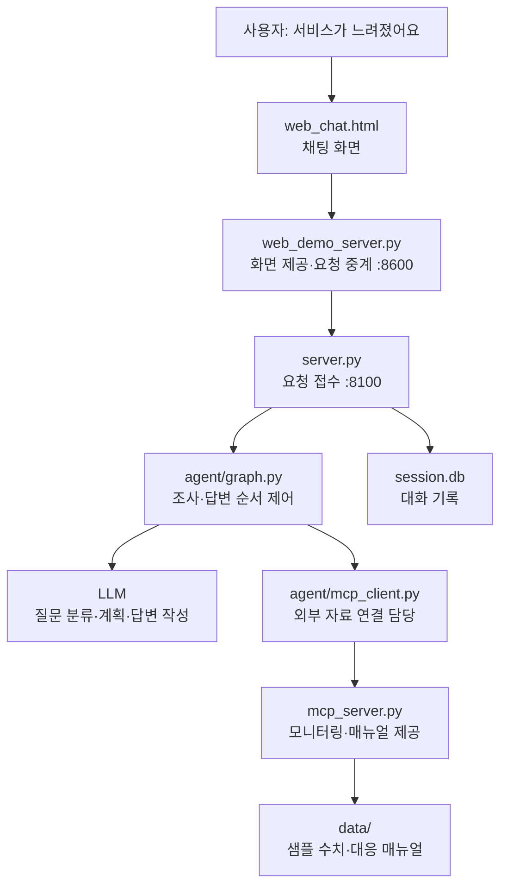

> 보관 문서: 이전 분석·실습·개선 단계의 기록입니다. 현재 프로젝트 설명은 [통합 README](/Users/user/mini-project/all_total_vue_student/README.md)를 기준으로 읽으세요.

# 프로젝트 구조와 개선 내용 쉽게 이해하기

> **최신 개선:** 실제 로컬 모니터링, 원문 단계·의미 검증, 복합 증상 검색, 기록 복원·실행 재개, 토큰/비용 표시를 추가했습니다. [남은 한계 개선과 현재 동작](/Users/user/mini-project/all_total_vue_student/doc/archive/REMAINING_LIMITS.md)에서 확인하세요. 아래의 이전 개선 단계 설명과 실측은 당시 기록입니다.

> **현재 상태:** 이 문서의 6~7장은 1차 개선의 비교 기록입니다. 이후 실제 OpenAI·Ollama 연결,
> RAG, 출처 표시, 비동기 모델 호출을 추가했습니다. 최신 동작과 실측은
> [실제 모델·RAG 설명](/Users/user/mini-project/all_total_vue_student/doc/archive/RAG_REAL_MODELS.md)에서 확인할 수 있습니다.

> 이 문서는 개선 전 프로젝트가 어떤 서비스였는지, 각 파일이 무슨 일을 하는지, 이번 개선으로 무엇이 달라졌는지를 설명합니다.
>
> 여기서 **개선 전**은 처음 제공된 학생용 스켈레톤의 기본 `v2` 버전입니다. 비교용 예제인 `supervisor_v1.py`와 구분해야 합니다.

## 1. 이 프로젝트는 무엇인가요?

**서비스에 문제가 생겼을 때, 상태를 조사하고 대응 매뉴얼을 찾아 설명해주는 AI 채팅 서비스입니다.**

예를 들어 운영 담당자가 다음과 같이 질문합니다.

```text
payments-service CPU가 급증했어요. 원인을 진단해줘.
```

그러면 프로그램은 다음 일을 합니다.

1. 장애 관련 질문인지 판단합니다.
2. 어떤 시스템을 확인할지 조사 계획을 세웁니다.
3. 모니터링 도구로 해당 시스템의 상태와 CPU·메모리 값을 조회합니다.
4. 증상에 맞는 대응 매뉴얼을 읽습니다.
5. 필요한 경우 여러 시스템의 결과를 비교합니다.
6. 조사 결과를 바탕으로 답변을 만들고 검증합니다.
7. 최종 결과를 채팅 화면에 보여줍니다.

채팅 화면에는 조사 계획, 자료 조회, 재작성 같은 진행 상황도 표시됩니다. 인사나 이름을 기억하는 간단한 대화는 조사 단계를 건너뛰어 바로 답합니다.

### 지금 연결된 데이터는 어디에서 오나요?

기본 서비스 6종은 샘플이며, 최신 개선에서는 **실제 `local-host` 측정과 설정형 Prometheus 연결**을 추가했습니다.

| 조사 대상 | 샘플에서 표현하는 상황 |
| --- | --- |
| `auth-service` | 로그인 응답 지연, 연결 풀 사용량 증가 |
| `web-01` | 정상 상태인 웹 서버 |
| `payments-service` | 결제 서비스의 높은 CPU 사용률 |
| `cache-service` | 캐시 서비스의 메모리 증가 |
| `gateway-service` | 다른 서비스 호출 중 타임아웃 |
| `log-service` | 로그 저장 공간 부족 |

기준값은 `data/monitoring.json`에 있고, 조회할 때 작은 임의 변동값을 더합니다. 대응 매뉴얼은 `data/runbooks/`의 Markdown 파일입니다.

따라서 현재 서비스는 **상태를 조회하고 조치를 안내**합니다. 실제 서버 재시작·파일 삭제·배포 롤백을 실행하지는 않습니다.

## 2. 전체 구조를 한눈에 보기



자료 연결을 위해 `docs`라는 두 번째 MCP 서버도 기동합니다. 이 서버의 문서를 실제 진단에 사용하지는 않으며, 여러 서버 중 필요한 자료를 제공하는 서버를 찾는 실습을 위한 구성입니다.

### 기술 이름을 쉬운 말로 바꾸면

| 기술·용어 | 이 프로젝트에서 하는 일 | 비유 |
| --- | --- | --- |
| Vue | 채팅 입력과 답변을 화면에 표시 | 사용자 창구 |
| FastAPI | 질문을 받고 결과를 돌려줌 | 접수 담당 |
| LangGraph | 분류·조사·작성·검증의 순서와 반복을 정함 | 업무 흐름표 |
| LLM | 문장을 이해하고 계획·답변을 생성 | 글을 읽고 작성하는 담당자 |
| MCP | 프로그램이 도구·문서를 일정한 방식으로 요청하도록 연결 | 자료 요청 규격 |
| SQLite | 대화 내용을 파일에 저장 | 대화 기록장 |
| LangSmith | 어느 단계에서 무엇을 했는지 실행 기록을 추적 | 작업 기록·추적 화면 |
| 의존성 주입 | 노드에 필요한 모델·도구·저장소를 묶어서 전달 | 작업 도구 상자를 전달하는 방식 |

여러 역할을 나누어 처리하지만, 현재는 한 LangGraph 안의 노드가 주로 역할을 수행합니다. 각 역할이 모두 별도의 독립 에이전트나 하위 그래프로 구현되어 있는 것은 아닙니다.

## 3. 개선 전에는 어떤 순서로 동작했나요?

원본에도 아래와 같은 처리 흐름이 이미 있었습니다. 이번에 처음부터 새로 만든 흐름은 아닙니다.

```text
질문 입력
   ↓
route: 일반 대화인가, 장애 질문인가?
   ├─ 일반 대화 → chat_answer: 바로 답변
   └─ 장애 질문
         ↓
       plan: 조사할 작업 목록 만들기
         ↓
       gate: 불필요한 분석 작업 제거
         ↓
       research: 모니터링·매뉴얼 조회
         ↓
       replan_check: 정보가 충분한가?
         ├─ 부족 → 필요한 조사 작업 추가 → research로 돌아감
         └─ 충분
              ↓
            analysis: 비교 분석 작업이 있으면 실행
              ↓
            write: 답변 초안 작성
              ↓
            validate: 초안 검사
              ├─ 반려 → write로 돌아가 다시 작성
              └─ 통과 → finalize: 최종 답변
```

### 원본이 이미 제공하던 기능

- 서버 시작 시 모델·MCP 연결·그래프를 만들고 요청마다 재사용합니다.
- 여러 조사 작업을 비동기로 실행합니다.
- 모니터링 조회에서 일시적인 타임아웃이 발생하면 재시도합니다.
- 결과가 부족하면 런북 조회 작업을 추가합니다.
- 검증에 실패하면 답변을 다시 작성합니다.
- 대화를 SQLite에 저장하는 기능이 있습니다.
- `fake`, `ollama`, `openai` 모델 구현을 교체할 수 있습니다.

다만 **기능이 존재하는 것과 그 기능이 충분히 정확하게 동작하는 것은 별개**였습니다. 이번에는 그 사이의 구체적인 문제를 수정했습니다.

## 4. 폴더 구조

아래 트리의 기준 위치는 `/Users/user/mini-project/all_total_vue_student`입니다.

```text
all_total_vue_student/
├── server.py                  요청을 받는 백엔드
├── web_chat.html              사용자가 보는 채팅 화면
├── web_demo_server.py          화면 제공·백엔드 중계
├── mcp_server.py               모니터링·매뉴얼·절차 제공
├── mcp_server_docs.py          다중 MCP 서버 탐색 실습용
├── requirements.txt           필요한 패키지 목록
├── requirements.lock.txt      이번 검증 환경의 정확한 패키지 버전
├── .env.example               환경 설정 양식
├── .gitignore                 Git에 포함하지 않을 파일 목록
├── agent/                     질문 처리와 답변 생성 로직
├── data/                      샘플 모니터링·대응 매뉴얼
├── sh/                        설치·실행 스크립트
├── scripts/                   통합 실행·실제 모델 검증
├── tests/                     자동 검사
├── eval/                      개선 전후 검증기 비교
└── doc/                       설명서·사용 예시·화면 이미지

실행 환경·실행 중 생기는 파일:
├── .venv/                     프로젝트 전용 Python 실행 환경
├── .env                       실제 실행 설정을 저장할 위치
├── session.db                 실행 중 생성되는 대화 기록
└── __pycache__/               Python이 자동 생성하는 캐시
```

최초에는 `.env.example`만 있었습니다. 현재는 입력된 설정을 실제 실행용 `.env`로 보존했고 양식에서는 키 값을 제거했습니다. API 키 값은 이 문서에 기록하지 않았습니다.

## 5. 각 파일은 무슨 일을 하나요?

표의 **유지**는 이번 1차 개선에서 내용을 바꾸지 않았다는 뜻입니다. 프로젝트에서 중요하지 않다는 뜻은 아닙니다.

### 5-1. 프로젝트 입구와 실행 설정

| 파일 | 역할 | 이번 상태 |
| --- | --- | --- |
| `server.py` | 질문을 접수하고 그래프를 실행합니다. 응답·진행 이벤트·대화 저장을 담당합니다. | 수정 |
| `web_chat.html` | 질문 입력, 답변 말풍선, 조사 진행 상황을 보여줍니다. | 수정 |
| `web_demo_server.py` | 채팅 화면을 제공하고 요청을 백엔드로 중계합니다. 화면 주소는 8600, 백엔드는 8100입니다. | 유지 |
| `mcp_server.py` | 모니터링 조회, 런북 조회, 표준 진단 절차와 RAG 검색 Tool을 제공합니다. | 수정 |
| `mcp_server_docs.py` | 별도 API 문서 자료를 제공하는 두 번째 MCP 서버입니다. 실제 장애 답변에는 사용하지 않습니다. | 유지 |
| `requirements.txt` | FastAPI·LangGraph·MCP 등 설치할 패키지와 허용 버전 범위를 적습니다. | 유지 |
| `requirements.lock.txt` | 이번에 설치하고 검증한 패키지 버전을 고정 목록으로 기록합니다. 기존 설치 스크립트는 여전히 `requirements.txt`를 사용합니다. | 추가 |
| `.env.example` | API 키·추적 설정 등을 어떤 변수 이름으로 작성할지 보여주는 설정 양식입니다. | 사용자 편집 영역 |
| `.env` | 실행 스크립트와 `load_dotenv()`가 읽는 실제 설정 파일입니다. | 설정 시 준비 |
| `.gitignore` | `.env`, `.venv/`, `session.db`, 캐시·로그 등을 Git에서 제외합니다. | 유지 |

MCP 서버가 제공하는 세 가지를 구분하면 이해하기 쉽습니다.

| 종류 | 실제 이름 | 용도 |
| --- | --- | --- |
| Tool | `get_monitoring_status` | “지금 이 시스템 상태를 조회해줘” |
| Resource | `runbook://incident-response/{incident_type}` | “이 유형의 대응 매뉴얼을 읽어줘” |
| Prompt | `incident_analysis_prompt` | “조사할 때 따라야 할 표준 절차를 알려줘” |

### 5-2. `agent/`: 실제 업무 처리 담당

| 파일 | 쉬운 설명 | 주요 내용 | 이번 상태 |
| --- | --- | --- | --- |
| `graph.py` | 업무 흐름의 중심 | 요청 분류, 계획, 조사, 재계획, 분석, 작성, 검증 노드와 연결 | 수정 |
| `deps.py` | 노드에 전달할 도구 상자 | 모델 두 종류, MCP 연결, 세션 저장소, 버전 정보를 묶는 `SupervisorDeps` | 유지 |
| `mcp_client.py` | 자료 요청 담당 | ops·docs 서버 연결, 필요한 자료·절차 탐색, 도구 호출과 도구 오류 확인 | 수정 |
| `fake_llm.py` | 모델 없이 흐름을 확인하는 대역 | 정해진 규칙으로 분류·계획·답변 생성. 실제 AI 추론은 수행하지 않음 | 수정 |
| `ollama_llm.py` | 로컬 모델 연결 담당 | Ollama 비동기 모델 어댑터 | 수정 |
| `openai_llm.py` | 원격 모델 연결 담당 | OpenAI 비동기 모델 어댑터 | 수정 |
| `http_llm.py` | 실제 통신 담당 | OpenAI SSE·Ollama NDJSON 수신, 사용량 집계, 오류 처리 | 2차 추가 |
| `llm_common.py` | 모델 공통 업무 규칙 | 분류·전체 대상 계획·구조화 보고서·출처 규칙 | 2차 추가 |
| `rag.py` | 문서 검색 담당 | 런북 청크 생성·임베딩·SQLite 캐시·코사인 유사도 검색 | 2차 추가 |
| `validation.py` | 답변 검사 담당 | 형식, 모니터링·매뉴얼 존재 여부, CPU·메모리 수치 대조, 실패 시 제한 응답 | 추가 |
| `retry.py` | 일시적인 실패의 재시도 담당 | TimeoutError가 나면 대기 시간을 늘려 재시도. 다른 오류는 그대로 전달 | 유지 |
| `session_store.py` | 대화 기록 담당 | SQLite에서 대화 조회·저장 | 유지 |
| `supervisor_v1.py` | 단순한 과거 버전 예제 | v2의 라우팅·재계획·검증 없이 단순한 처리 경로 실행 | 유지 |
| `__init__.py` | Python 패키지 표시 | `agent` 폴더를 모듈 묶음으로 사용 | 유지 |

`session_store.py`를 수정하지 않았어도 기록 유지 동작은 개선되었습니다. 저장소가 아닌 **기록을 삭제하던 실행 스크립트와 매번 대화 ID를 바꾸던 화면**을 수정했기 때문입니다.

### 5-3. `data/`: 조회할 샘플 자료

| 파일 | 내용 |
| --- | --- |
| `monitoring.json` | 시스템별 상태, CPU·메모리 기준값, 알림 문자열 |
| `runbooks/cpu-spike.md` | CPU 급증 시 확인·대응 절차 |
| `runbooks/memory-leak.md` | 메모리 증가·누수 시 대응 절차 |
| `runbooks/disk-full.md` | 디스크 공간 부족 시 대응 절차 |
| `runbooks/high-latency.md` | 응답 지연 시 대응 절차 |
| `runbooks/network-timeout.md` | 네트워크 타임아웃 시 대응 절차 |
| `runbooks/db-down.md` | DB 장애 시 대응 절차 |

이번에는 이 데이터 파일들을 변경하지 않았습니다. 런북 선택도 기존 키워드 방식을 유지했습니다.

### 5-4. `sh/`: 설치와 실행을 편하게 하는 파일

| 파일 | 역할 | 이번 상태 |
| --- | --- | --- |
| `setup_venv.sh` | `.venv`를 만들고 Python 패키지 설치 | 유지 |
| `setup_ollama.sh` | 로컬 모델 준비. 이미 있는 모델은 재사용하고 필요하면 내려받음 | 유지 |
| `run_agent_ollma.sh` | Ollama를 사용하는 백엔드 실행. 파일명의 `ollma`는 원본 표기 | 수정 |
| `run_agent_openai.sh` | OpenAI를 사용하는 백엔드 실행 | 수정 |
| `run_frontend.sh` | 이미 실행된 백엔드 앞에 채팅 화면 서버 실행 | 유지 |
| `run_demo.sh` | fake 모드의 백엔드와 화면 서버를 함께 실행 | 추가 |
| `run_live.sh` | 실제 모델 기본 설정으로 백엔드와 화면 함께 실행 | 2차 추가 |
| `make_student_zip.sh` | 배포용 ZIP 생성. `.env`·가상환경·대화 DB는 제외하고 `.env.example`은 포함 | 유지 |

두 모델 실행 스크립트에서는 시작 시 대화 DB를 삭제하던 줄을 제거했습니다. 새 데모 스크립트는 포트를 이미 사용 중이면 중복 실행을 중단하고, 종료 시 자신이 실행한 서버를 정리합니다.

### 5-5. `tests/`와 `eval/`: 개선 결과 확인

| 파일 | 역할 | 이번 상태 |
| --- | --- | --- |
| `tests/test_improvements.py` | 수치 검증, 실패 상한, 초안 비노출, 기록 보존, 대상 확인, 부분 실패 검사 | 추가·확장 |
| `tests/test_api.py` | 실제 MCP 서버를 연결해 HTTP·SSE·v1 재시작 후 대화 복원 검사 2개 수행 | 추가 |
| `tests/test_rag_models.py` | 임베딩 캐시·출처·모델 스트림·구조화 보고서 검사 | 2차 추가 |
| `eval/validation_cases.json` | 통과·반려 여부를 사람이 지정한 고정 검증 사례 10개 | 추가 |
| `eval/compare_validation.py` | 같은 사례에 기존 규칙과 개선 규칙을 적용해 비교 | 추가 |
| `eval/validation_results.json` | 사례별 판정과 비교 결과 저장 | 추가 |
| `eval/compare_retrieval.py`, `eval/retrieval_cases.json` | 기존 규칙과 의미 검색을 같은 12개 사례로 비교 | 2차 추가 |
| `eval/retrieval_results.json` | 의미 검색의 문서 회수율·정확 일치 결과 | 2차 추가 |
| `eval/live_verification.json` | 실제 모델·RAG 전체 흐름 검증 결과 | 2차 추가 |

자동 검사는 **수정한 기능이 의도대로 동작하는지** 확인합니다. 비교 평가는 **동일한 사례에서 기존보다 판정이 나아졌는지** 확인합니다.

### 5-6. `doc/`: 사람이 읽는 설명

| 파일·폴더 | 역할 | 이번 상태 |
| --- | --- | --- |
| `README.md` | 원본 통합 실습의 구조·실행 방법 설명. 상단에 개선 문서 안내 추가 | 수정 |
| `PROJECT_WALKTHROUGH.md` | 지금 읽고 있는 프로젝트·파일 구조·개선 설명 | 이번 요청으로 추가 |
| `IMPROVEMENTS.md` | 1차 개선의 실행 방법, 변경 사항, 검증 결과, 한계 | 추가 |
| `RAG_REAL_MODELS.md` | 실제 모델과 RAG의 현재 구조·실측·한계 | 2차 추가 |
| `manual_ollma.md` | 로컬 모델의 사용 사례 설명 | 유지 |
| `manual_openai.md` | OpenAI 모델의 사용 사례 설명 | 유지 |
| `regression_test_queries.md` | 직접 입력해볼 기존 테스트 질문 목록 | 유지 |
| `image_usecase/`, `image_usecase_openai/` | 기존 매뉴얼의 예시 화면 이미지 | 유지 |
| `improved-demo.jpg` | 1차 개선 후 브라우저에서 확인한 데모 화면 | 추가 |

원본 매뉴얼이 설명하는 자동 평가·실패 사례 편입 기능의 실행 파일은 학생 배포본에 없었습니다. 이번에 추가한 `eval/`은 **답변 검증기를 비교하는 별도 평가**이며, 원본 매뉴얼의 모든 평가 기능을 복원한 것은 아닙니다.

### 5-7. `scripts/`: 실제 모델 실행과 검증

| 파일 | 역할 |
| --- | --- |
| `run_service.py` | `.env`를 읽고 백엔드·화면 서버를 실행. 자신이 시작한 서버만 종료 |
| `verify_live.py` | 실제 OpenAI·Ollama 응답과 임베딩·전체 진단 흐름 검증 |

## 6. 개선 후 무엇이 달라졌나요?

### ① 답변의 모양에 더해 실제 조회 수치도 검사합니다

**기존:** 30자 이상이고 `1)`가 들어 있으면 통과했습니다.

설명을 위한 예로, 실제 조회값이 CPU 78.2%여도 다음 답변은 형식만 맞으면 통과할 수 있었습니다.

```text
1) auth-service CPU는 999%입니다. 원인과 최근 변경 사항을 확인하세요.
```

**개선:** 지원하는 CPU·메모리 백분율 표현을 모니터링 원본과 대조합니다. 위 예시는 불일치로 반려합니다. 시스템 이름이 앞에 명시된 경우에는 다른 시스템의 수치를 가져왔는지도 검사합니다.

수정 위치: `agent/graph.py`, 추가 위치: `agent/validation.py`.

### ② 세 번 틀려도 합격으로 바꾸지 않습니다

```text
기존: 실패 → 재작성 → 실패 → 재작성 → 또 실패해도 합격 처리

개선: 실패 → 재작성 → 실패 → 재작성 → 최종 실패 유지
                                           ↓
                             확인된 모니터링 정보만 안내
```

최종 실패 시 생성된 초안을 그대로 보내지 않고 원본 데이터에서 시스템 상태·CPU·메모리만 정리합니다. 원인과 조치는 확정할 수 없다고 알립니다.

반복 횟수 상한은 유지해 무한 재작성을 막습니다. **반복 종료와 답변 합격을 구분**한 것입니다.

수정 위치: `agent/graph.py`, 추가 위치: `agent/validation.py`.

### ③ 검증받기 전의 장애 답변은 화면에 보내지 않습니다

**기존:** 초안이 만들어지는 동안 화면에 보내고, 그 후에 검증했습니다. 나중에 반려되어도 사용자는 이미 잘못된 내용을 볼 수 있었습니다.

**개선:** 장애 답변은 검증이 끝난 뒤 결과를 보여줍니다. 계획·조회·작성·검증 같은 진행 상황은 계속 표시합니다. 일반 대화의 응답 경로는 유지했습니다.

대신 사용자가 장애 답변의 첫 글자를 보기까지 기다리는 시간이 늘어날 수 있습니다.

수정 위치: `agent/graph.py`.

### ④ 매뉴얼이 없으면 정보가 충분하다고 표시하지 않습니다

**기존:** 런북 항목이 하나라도 있으면 충분하다고 판단했습니다. 내용이 `Runbook Not Found`여도 통과할 수 있었습니다. 재계획 상한에 도달한 경우도 충분하다고 표시했습니다.

**개선:** 빈 문서와 `Runbook Not Found`를 제외합니다. 재계획 상한에 도달하면 추가 조사는 종료하되, 정보 부족 상태를 유지합니다. 답변 검증 단계에서도 유효한 매뉴얼이 있는지 확인합니다.

수정 위치: `agent/graph.py`, 추가 위치: `agent/validation.py`.

### ⑤ 기존 대화 기록을 계속 사용할 수 있게 했습니다

| 상황 | 기존 | 개선 |
| --- | --- | --- |
| 모델 실행 스크립트로 서버 재시작 | 시작하면서 `session.db` 삭제 | 대화 DB 유지 |
| 같은 브라우저에서 새로고침 | 새로운 대화 ID 생성 | 저장된 대화 ID 재사용 |
| v1의 SSE로 대화 | 대화 저장 누락 | 사용자·답변 메시지 저장 |

예를 들어 “제 이름은 민수입니다”라고 말한 뒤 새로고침하고 이름을 물으면, 같은 대화 기록을 활용할 수 있습니다.

이 1차 개선 당시에는 화면 복원·후속 질문·실행 재개가 없었습니다. 최신 개선에서 이 기능을 추가했습니다. 상세 동작과 범위는 [남은 한계 개선과 현재 동작](/Users/user/mini-project/all_total_vue_student/doc/archive/REMAINING_LIMITS.md)을 참고하세요.

수정 위치: 모델 실행 스크립트 2개, `web_chat.html`, `server.py`.

### ⑥ 데모에서 기존 기능을 더 정확하게 확인하도록 보완했습니다

- “메모리 증가”, “디스크 부족”, “응답이 느려요” 같은 기존 장애 질문을 fake 모드가 인사로 처리하던 경우를 보완했습니다.
- 요청하지 않은 `web-01`을 fake 모드에서 무조건 조사하던 동작을 제거했습니다.
- 복수 시스템의 비교·공통 원인 질문에서는 fake 계획에 있는 분석 작업을 실행할 수 있도록 판단을 보완했습니다. fake 답변 작성기는 여전히 단순한 예제 구현입니다.
- fake 모드를 “실모델”이라고 표시하던 문구를 샘플·규칙 기반 모드로 수정했습니다.
- 화면에 서비스 설명과 예시 질문을 표시하고 연결 실패 안내를 보완했습니다.
- API 키 없이 흐름을 확인할 수 있는 `run_demo.sh`를 추가했습니다.

이는 fake 데모의 보완입니다. OpenAI·Ollama의 모델 성능을 개선했다고 주장하는 변경은 아닙니다.

수정 위치: `agent/fake_llm.py`, `web_chat.html`, 추가 위치: `sh/run_demo.sh`.

## 7. 개선 결과는 어떻게 확인했나요?

### 자동 검사: 16개 통과

검사한 내용에는 잘못된 CPU·메모리 수치 반려, 시스템별 수치 혼동, 문서 부재, 3회 실패 후 제한 응답, 검증 전 초안 비노출, 대화 기록 보존이 포함됩니다.

실제 MCP subprocess를 연결한 API 검사와 브라우저에서의 진행 화면·새로고침 후 대화 기억도 확인했습니다. 실제 OpenAI·Ollama 호출은 아직 검증하지 않았습니다.

### 고정 사례 10개에서 검증기 판정 비교

| 항목 | 개선 전 | 개선 후 |
| --- | ---: | ---: |
| 정해둔 기대 판정과 일치한 사례 | 4/10 | 10/10 |

여기서 **올바른 판정**은 통과해야 할 답변은 통과시키고, 반려해야 할 답변은 반려했다는 뜻입니다. 실제 모델의 답변 정확도가 100%라는 의미는 아닙니다. 수동으로 작성한 작은 고정 사례 집합에 대한 회귀 검사입니다.

재실행할 때는 프로젝트 폴더에서 다음 명령을 사용합니다.

```bash
.venv/bin/python -m unittest discover -s tests -v
.venv/bin/python eval/compare_validation.py
```

## 8. 여전히 남아 있는 한계

| 남은 부분 | 현재 상태 |
| --- | --- |
| 런북 선택 | 2차 개선에서 시스템별 임베딩 검색으로 변경했습니다. 기본은 시스템별 상위 문서 1개입니다. |
| 답변 검증 범위 | 정해진 표현의 CPU·메모리 수치를 확인합니다. 모든 문장의 의미·원인·조치를 검증하지 않습니다. |
| 대상 시스템 식별 | 명시한 미등록 시스템은 확인을 요청합니다. 실제 모델의 계획에서 일부 알려진 대상이 빠지면 보완합니다. |
| 샘플 데이터 | 실제 운영 로그·시계열 모니터링이 아닙니다. |
| 실제 모델 연결 | 2차 개선에서 OpenAI·Ollama 모두 실제 호출과 전체 흐름을 검증했습니다. |
| 응답 전송 | 실제 모델의 일반 대화는 토큰 수신을 중계합니다. 장애 답변은 구조화 생성과 검증 후 표시합니다. |
| 동시 요청 | 실제 모델 HTTP 호출을 비동기로 바꿨습니다. 모델 처리 자원과 MCP 연결 락에 따른 대기는 남습니다. |
| 대화 기억 | 메시지 저장과 대화 ID는 유지하지만, 과거 화면 복원·장애 조사 맥락 해석은 별도입니다. |
| 비용 표시 | 코드의 `cost_usd`는 고정 가상 단가를 사용한 비교용 값이며 실제 청구액과 다릅니다. |

이번 개선의 중심은 **조회한 수치를 더 정확히 인용하고, 검증 실패를 숨기지 않으며, 기존 대화 기록이 지워지지 않도록 하는 것**입니다.

## 9. API 키와 실행 모드의 관계

현재 코드는 **`.env`를 실제 설정 파일로 읽습니다.** 사용자가 `.env.example`에 입력했던 설정은 `.env`로 보존했고, `.env.example`은 비밀값 없는 양식으로 정리했습니다.

| 설정·실행 방식 | 적용 범위 |
| --- | --- |
| `OPENAI_API_KEY` | OpenAI 모델 구현이 실제 API를 호출할 때 사용 |
| `LANGCHAIN_API_KEY`와 추적 설정 | LangSmith에 실행 기록을 전송할 때 사용 |
| `LLM_BACKEND` | `fake`, `ollama`, `openai` 중 사용할 모델 구현 선택 |
| `SUPERVISOR_VERSION` | `v1`, `v2` 처리 흐름 선택. 기본 개선 대상은 v2 |
| `run_demo.sh` | fake 모드로 실행하고 LangSmith 추적을 끔. 키를 적어도 실제 모델로 자동 전환되지 않음 |

배포 스크립트는 `.env`를 제외하고 비밀값 없는 `.env.example`을 포함합니다. 이 문서에는 실제 키 값을 포함하지 않았습니다.

## 10. 코드를 읽는 추천 순서

1. `web_chat.html`: 사용자가 무엇을 입력하고 어떤 결과를 보는지 확인합니다.
2. `server.py`: 질문을 어디서 받고 그래프에 무엇을 넘기는지 확인합니다.
3. `agent/graph.py`: 분류부터 최종 답변까지의 흐름을 따라갑니다.
4. `mcp_server.py`와 `data/`: 실제로 어떤 자료를 조회하는지 확인합니다.
5. `agent/fake_llm.py`: API 호출 없이 각 역할의 입출력을 이해합니다.
6. `agent/validation.py`: 이번에 강화한 검증 기준과 실패 처리를 확인합니다.
7. `tests/`와 `eval/`: 그 동작을 어떤 사례로 검증했는지 확인합니다.

실행 방법과 간단한 변경 내역은 [IMPROVEMENTS.md](/Users/user/mini-project/all_total_vue_student/doc/archive/IMPROVEMENTS.md), 원본의 상세 구조 설명은 [README.md](/Users/user/mini-project/all_total_vue_student/doc/archive/README.md)에서 이어서 볼 수 있습니다.
